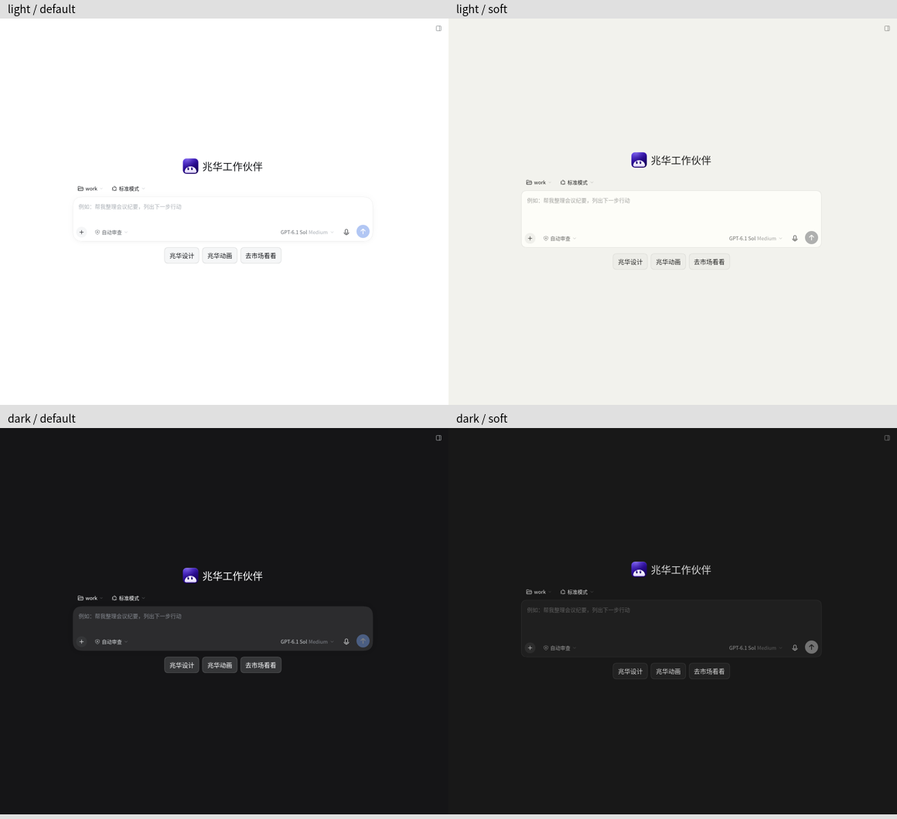
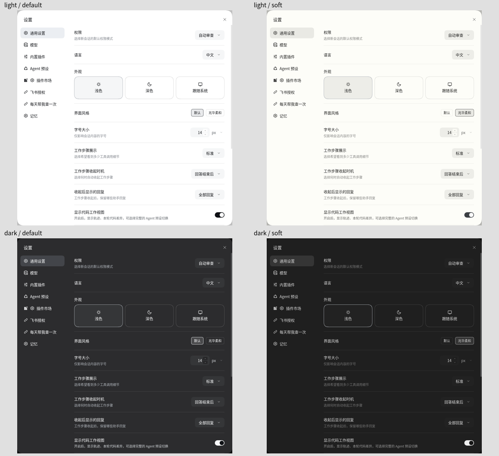

# 兆华柔和预览

基于登录后的真实网页，在本次独占的浏览器标签页中拦截品牌资源与公司客户端模块，用本分支文件替换响应。没有部署、更改授权或发送对话。截图裁去账号、会话列表和背景对话；每张对比图上行为浅色，下行为深色，左列为默认，右列为兆华柔和。

`verify-skin-browser.mjs` 用同一入口的已有浏览器会话复跑；需设置 `CDP_TAB`（自己创建的标签页）、`APP_ORIGIN`、`PLAYWRIGHT_MODULE`（已有的 Playwright 模块入口）、`EVIDENCE_DIR`（截图目录），可选 `CDP_ENDPOINT`、`CONVERSATION_TITLE`（只读验收用的已有会话标题，默认“问候”）。该脚本恢复原来的皮肤设备偏好，不安装依赖，不启动新浏览器。

网页完整矩阵：默认/柔和 × 浅色/深色 × 首页/对话/通用设置/市场/作品，共二十张，另有窄屏、收起侧栏各一张。明暗模式通过本标签页的主题属性模拟，不写账号的明暗偏好。另检查切换立即生效、刷新保持、head 阶段读取、默认背景与禁用样式表一致、窄屏无横向溢出、导航顺序不变、发送按钮前景与底色、Mac/Windows/网页侧栏填充。完整截图及报告保留在本轮工作目录，未将真实会话发布到公开仓库。

首屏证据确认同步脚本在应用模块运行前设置属性；镜像注入检查在临时目录执行 Dockerfile 的实际品牌脚本，桌面注入检查运行源文件的实际文档变换。尚未验证重建镜像后的线上首屏、桌面安装包及 Mac 原生毛玻璃窗口。侧栏整理单仍处原型阶段，本分支不改入口顺序；其后合入时需再核对样式钩子。
