# 原生设置截图预览

全部截图使用测试授权状态和本分支界面代码，放在真实 dsh 设置壳内渲染。没有连接或断开真实授权。项目状态使用 CLI 提供的剩余有效分钟数，已连接截图显示“已连接 · 还剩 3 天有效”，不新增项目授权时间记录。浏览器和桌面分支预览不证明提供方授权、真机或安装包行为。

| 场景 | 未连接 | 已连接 |
|---|---|---|
| 网页宽屏 | 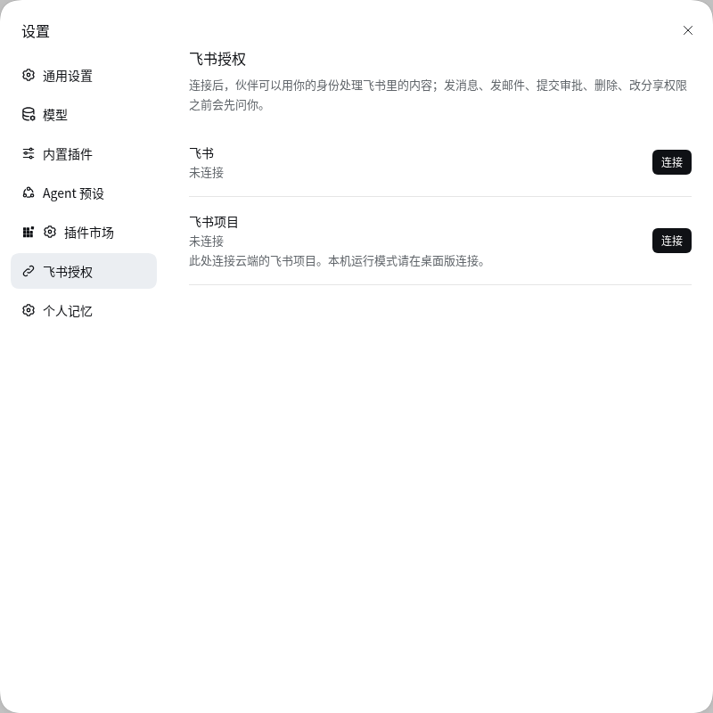 | 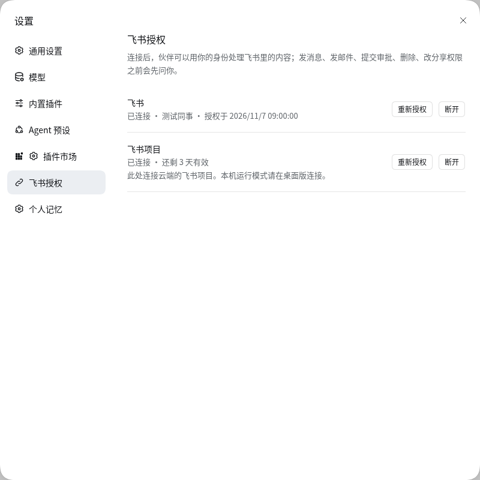 |
| 网页窄屏 | 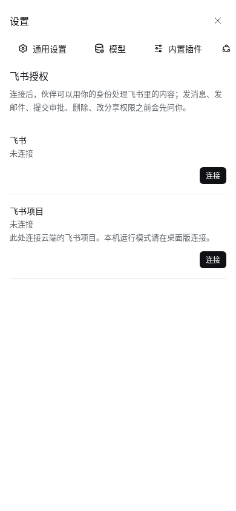 | 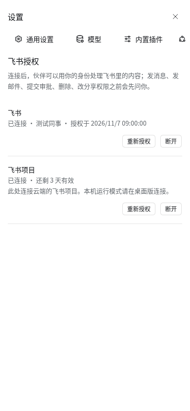 |
| 深色主题 | 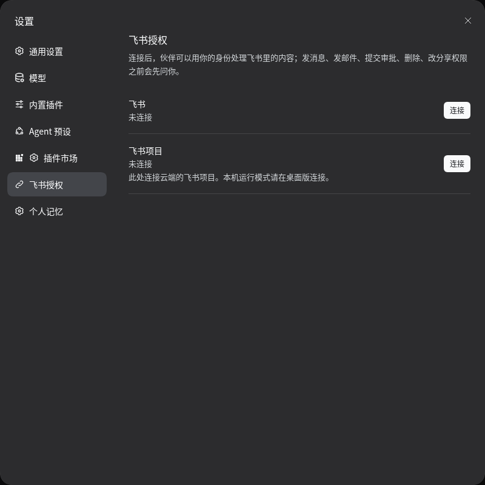 | 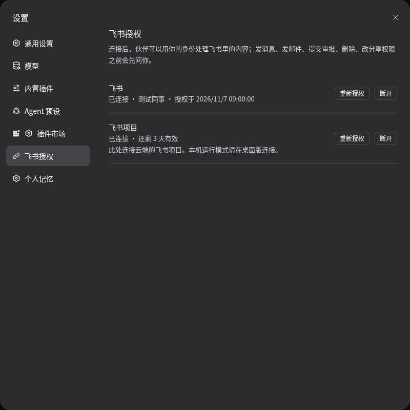 |
| 内置浏览器分支预览，非真机 | 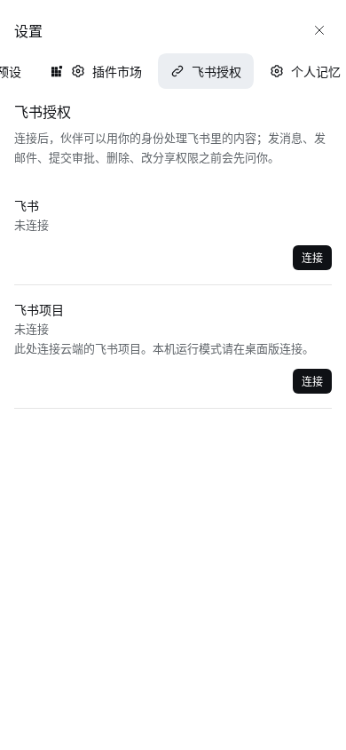 | 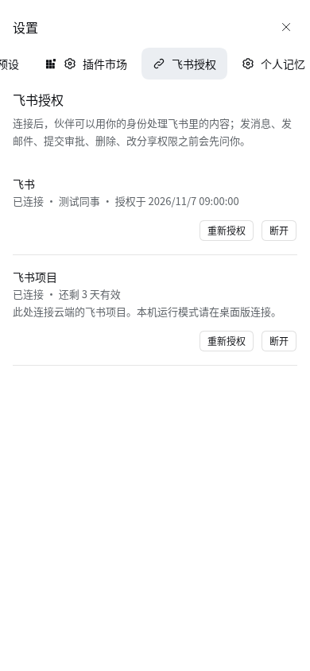 |
| 桌面分支预览，非安装包 | 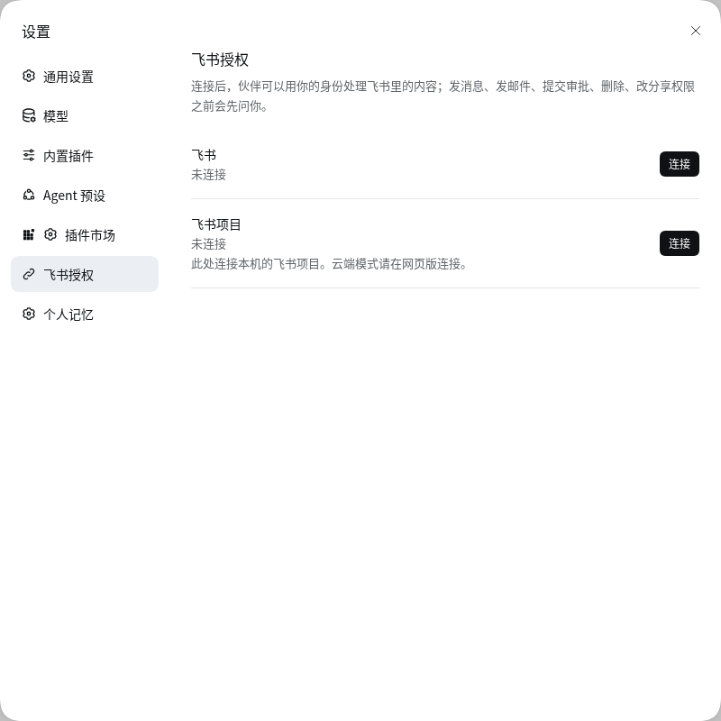 | 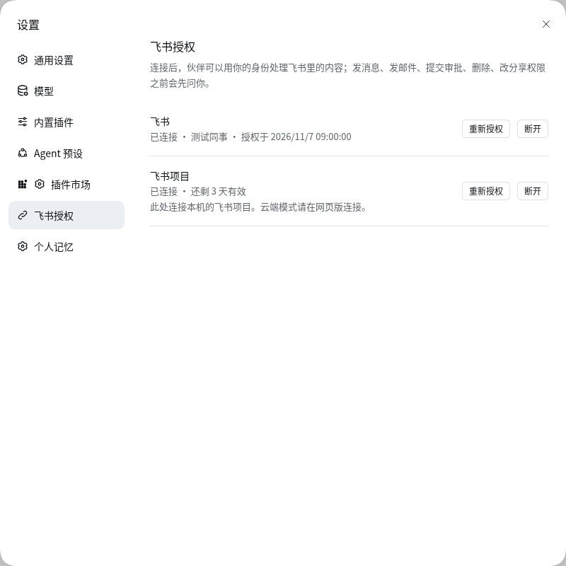 |

导航选中见宽屏截图，未选中如下：

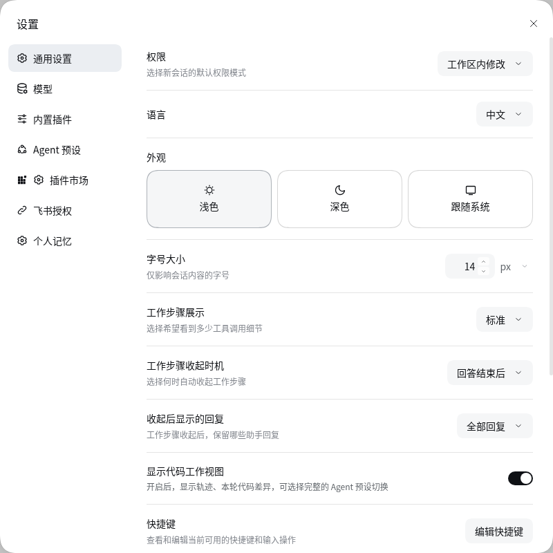

英文已连接预览：

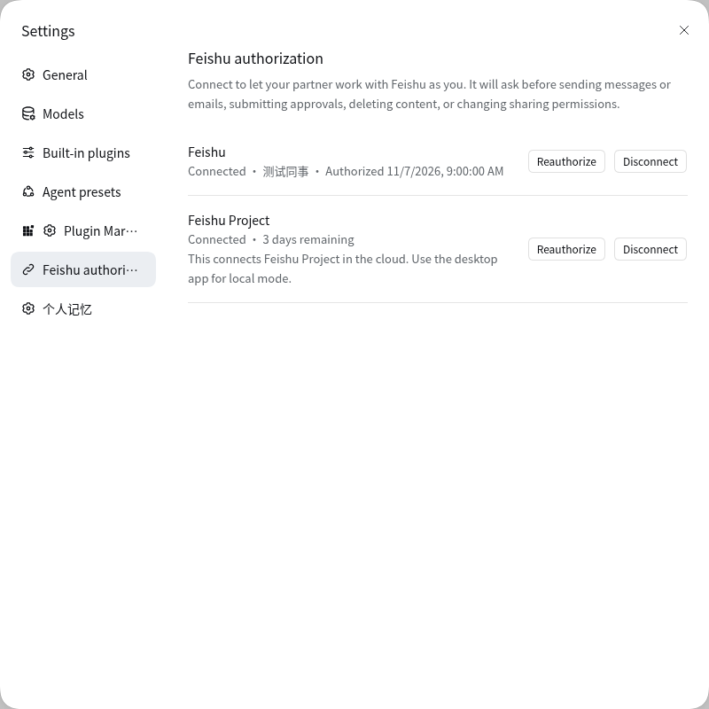

可使用上级目录的 `verify-browser.mjs` 重跑。同一浏览器入口中只操作本任务专用标签页，授权接口使用夹具。通过本任务标签页的浏览器语言分别验证中文和英文，不保存账号语言偏好；本地源文件直接注册为预览模块，不用动态函数构造器嵌入源码。脚本实际断言图标、选中状态、授权地址、焦点自动刷新、项目剩余有效期（完整天数、不足一天和未返回有效期）和断开确认／取消；移动端和桌面仅切换客户端分支。授权完成页的返回标记与运行时引导修补由轻量处理器测试覆盖。

截图对应的界面文件 SHA-256：

- `crysound/feishu/native/client.js`：`d4592d35172c9885b867ba9605b2afdf322c813b8d35361a04abcc0abb1179ad`
- `crysound/brand/brand.js`：`b171773c07592dbe3851916688afc459b8535440e2c753be3aabaeb113eaa638`
- `crysound/config/plugin-patches.mjs`：`1eac75eec2fcfd0558ca28b5d0be11f462ed4903467d30e33ddf196c119a6fa9`
