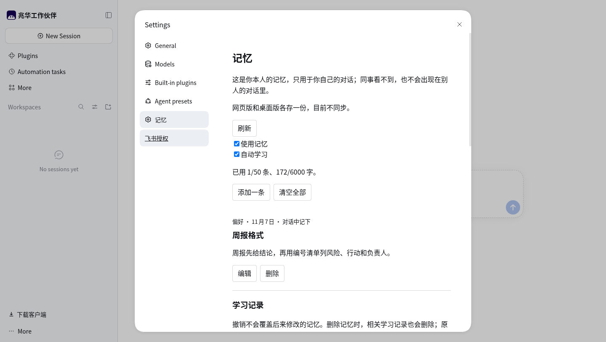
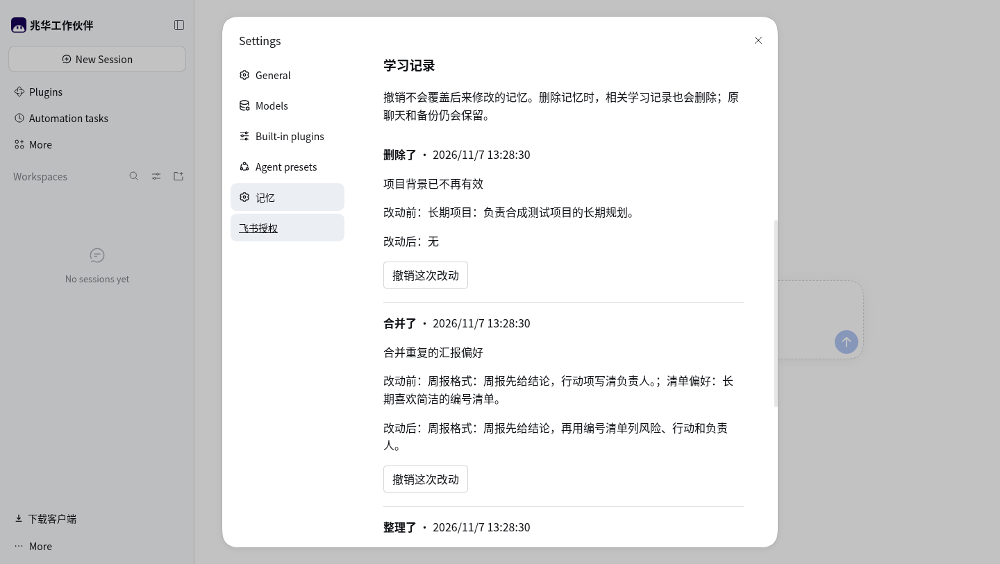
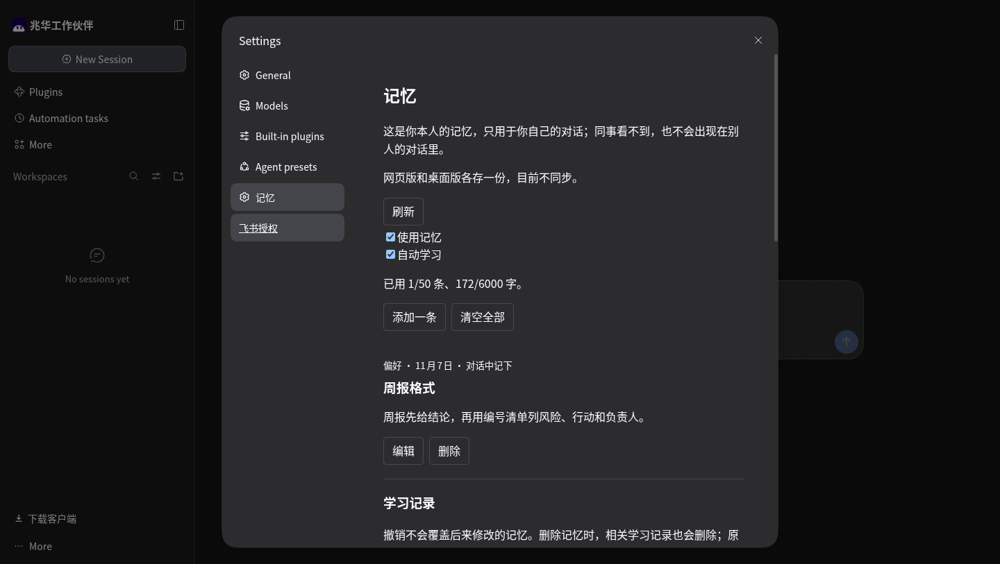
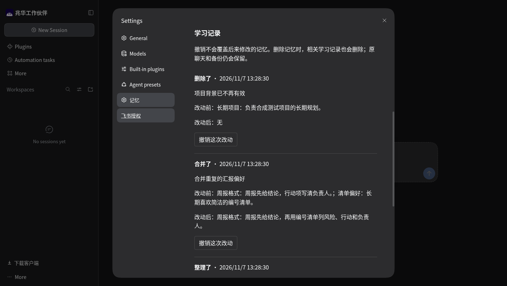

# 后台实现阶段的设置复查

本轮使用现有 dsh 0.2.2-rc.1 / Node 24.22.2 隔离宿主，在全新的合成数据目录启动本分支插件，沿用文档指定持久 CDP 的自有标签。没有假定后台执行继承了桌面浏览器。实际加载宿主设置页面，通过真实 HTTP 管理接口及鼠标操作复查六组行为，结果见 [result.json](result.json)。九张截图中保留四张：浅色和深色各自的双开关、学习记录。续做压力集时已逐张检查四张内容，并核对与原九张操作证据属于同一结果。设置组件未因取材修正而改变，未重跑或冒称新一轮网页验收。

四类学习记录由真实 MemoryStore 的专用夹具提交，不由模型生成。复查覆盖两个开关、重开持久化、逐条撤销删除、旧版本和后来编辑冲突、手动删除清历史以及清空。截图只证明设置和记录行为，不能证明真实辅助模型、15 分钟现场触发或提取率提升。后台回执的新增文字与共享轮询另由客户端行为测试覆盖，真实模型网页演示仍待完成；不嵌入伪装成完整学习的 GIF。

测试后关闭自有标签，停止并核实专用网页进程退出，不停止共享测试容器。重跑沿用 `tests/evidence/learning-preparation/README.md` 的步骤，但新建独立的空目录和 origin；不要重置其他测试或正式数据。
