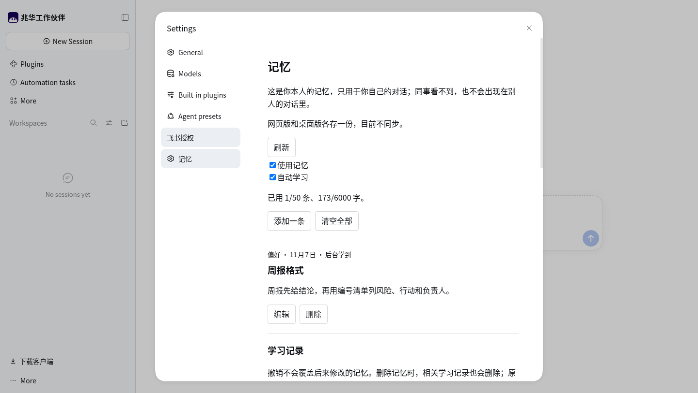
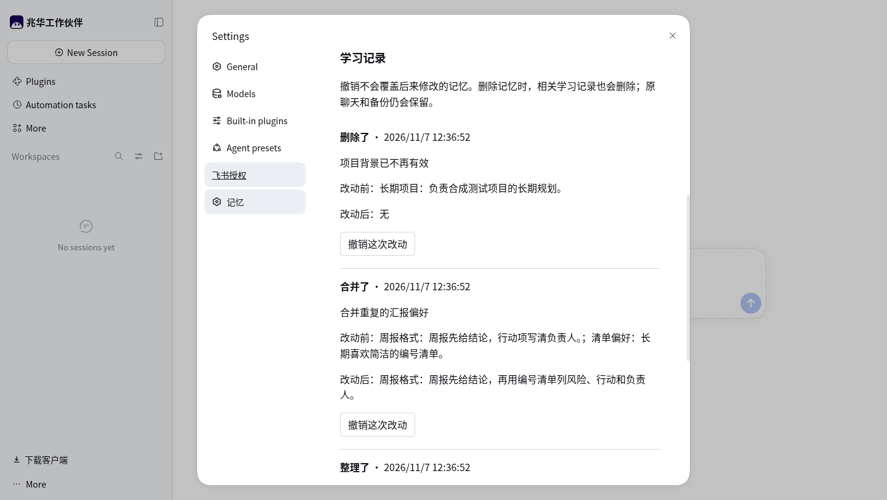
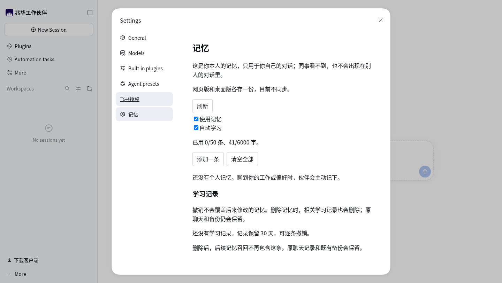
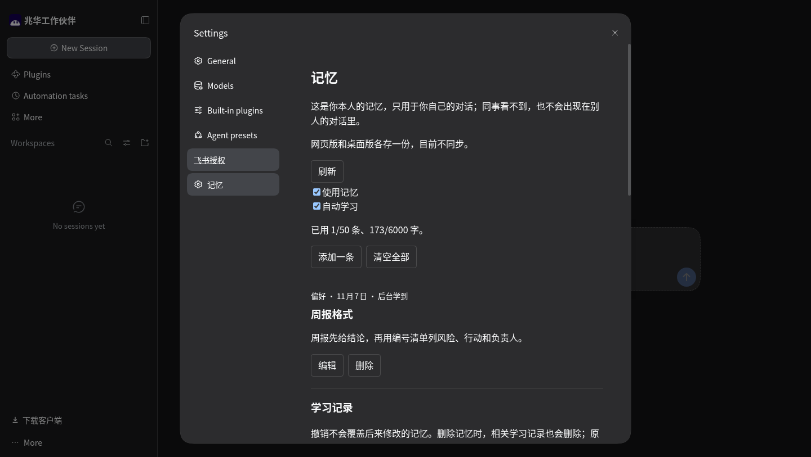
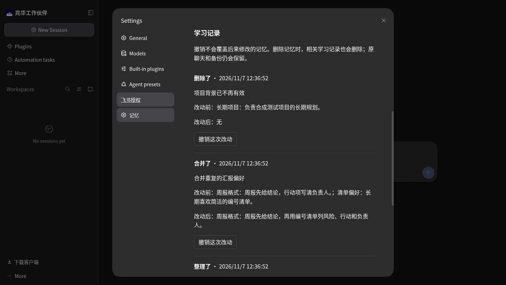
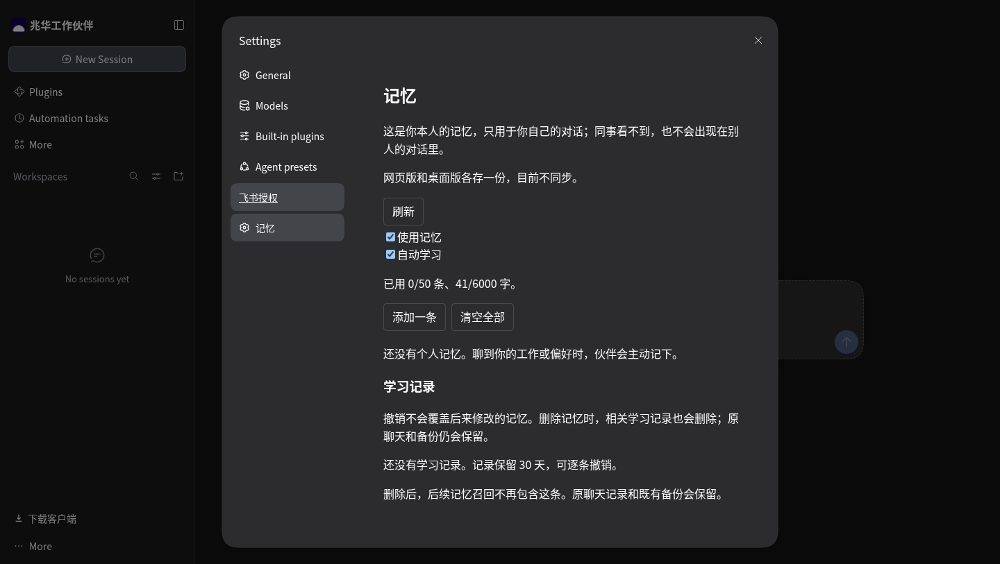

# 学习记录准备验证

来源是已安装的 dsh 0.2.2-rc.1 / Node 24.22.2，直接加载本分支未打包插件；使用新的隔离数据目录、profile 和独立网页 origin，没有修改正式用户或既有测试 profile。没有运行对话或学习模型，也没有把记录注入页面：`tests/learning-fixture.mjs` 经真实 MemoryStore 事务写入合成事实及四种改动，网页再通过真实管理接口读取。页面沿用当前 main 的设置组件，尚未接续未合入的 #83 原生样式改版。

浏览器沿用手册指定的持久 CDP 会话，在自己的标签页操作。`tests/learning-browser.mjs` 以 CDP 鼠标事件点击实际控件，依据页面和管理接口状态等待完成；浅色/深色均通过原生设置里的 Appearance 切换，没有注入样式或替换客户端函数。

复跑时先用受支持的 `dsh --profile <隔离 profile>` 启动该插件和空的测试数据目录，沿用网页目录选择器 overlay，不连接真实模型。对同一目录运行 `node tests/learning-fixture.mjs <隔离记忆目录>`，该命令遇到已有事实或历史会拒绝，不执行清空。打开自己的 CDP 标签和“设置 → 记忆”，设置 `CDP_TAB` 与专用 `MEMORY_TEST_ORIGIN`，运行 `node tests/learning-browser.mjs tests/evidence/learning-preparation`。浏览器脚本会对这些合成事实执行删除及清空，必须专用隔离环境；不应在正式账号运行。

[结果](result.json)记录六组通过的行为：四种记录与双开关、关闭后重开仍保留且不影响召回、撤销删除恢复、旧版本及后来编辑的冲突拒绝、删除同步清理三个相关历史、清空同时移除事实与记录。存储检查另外验证 30 天到期后的原文字节擦除、撤销超额回滚和原格式升级。

| 主题 | 开关 | 学习记录 | 空状态 |
| --- | --- | --- | --- |
| 浅色 |  |  |  |
| 深色 |  |  |  |

[关闭自动学习](dark-learning-off.png) · [撤销删除](dark-undo-delete.png) · [撤销冲突](dark-undo-conflict.png)。截图时间使用测试浏览器本地时区。记录列表为可滚动区域，截图分别展示开关与记录位置。没有制作完整学习演示 GIF，因为后台触发和学习模型尚未实现；不能把夹具生成的记录包装成自动学习效果。
