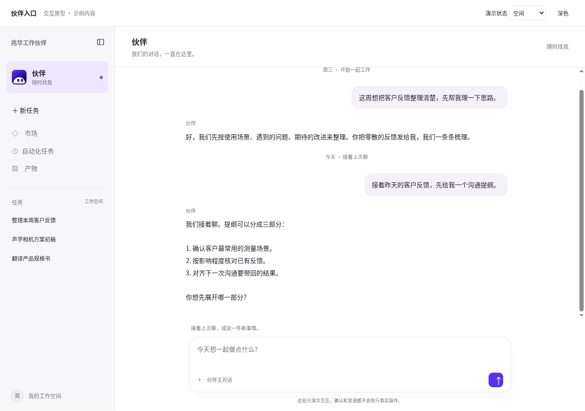
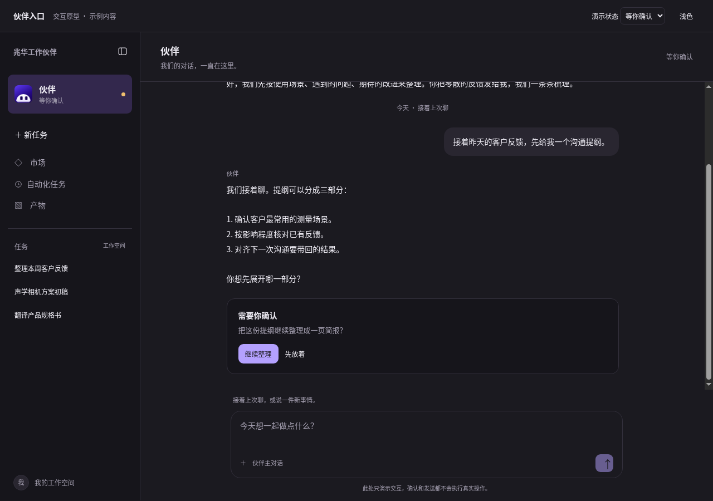
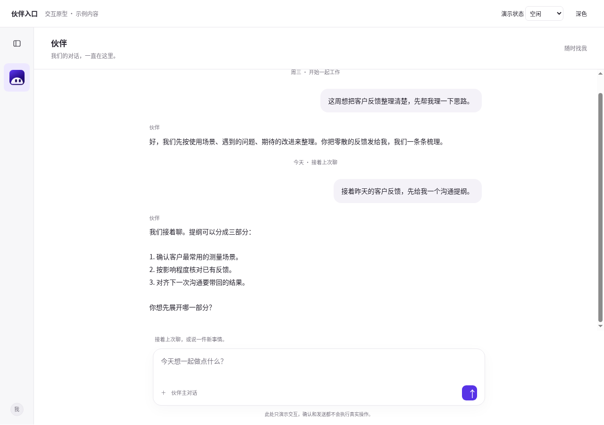
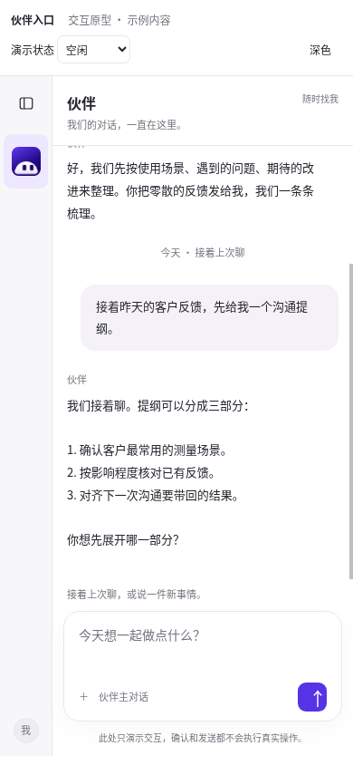

# 伙伴固定入口 · 可点原型

原型只供方向评审。入口固定在任务列表上方；点击进入同一条主对话，普通任务保留在下面；侧栏收起后仍能点击伙伴头像。头像直接复用 `crysound/brand/pet.js` 的生产组件，32 px 使用已有简化图形，没有引入其他产品的形象、提示词或代码。

## 打开

在仓库根目录运行（只需 Python 3，无需安装依赖、构建或模型调用）：

```sh
python3 -m http.server 8811 --bind 127.0.0.1
```

浏览器打开 <http://127.0.0.1:8811/crysound/prototypes/partner-entry/>。远程机器可把本地 8811 端口转发到运行机器的 8811 端口再打开。不支持双击 HTML 的 `file://` 方式，因为会动 logo 的预览加载器需要读取同仓库资源。

## 怎么看

1. 点击普通任务，再点顶部“伙伴”：主对话仍是原来的记录。点“新任务”也不会更换伙伴记录。
2. 点收起按钮：伙伴只显示头像，仍可点回主对话。
3. 输入一句话并点发送：依次演示思考、工作、等你确认；点“继续整理”后演示完成。点“先放着”回到空闲。所有内容都是本地示例，不调用模型、不发送消息、不生成真实文件。
4. 顶部下拉框可直接查看五种状态；右侧按钮切换深浅色。手机默认收起侧栏，可再展开。系统减少动态效果时仍以文字说明状态。
5. 同一浏览器刷新会保留本地示例对话。这个本地存储只属于原型，不代表产品已经有长期主对话或跨设备同步。

市场、自动化任务和产物在原型中仅作布局参照；本单没有实现这些页面。原型没有接入网关、镜像入口或桌面安装包。

## 截图与验证

| 浅色 | 深色／等你确认 |
| --- | --- |
|  |  |

| 收起侧栏 | 手机窄屏 |
| --- | --- |
|  |  |

已执行轻量语法检查、真实浏览器交互检查、四种截图核对。交互证据在 [browser-checks.json](evidence/browser-checks.json)，技术结论在 [technical-validation.md](technical-validation.md)。

复查原型（Node 22+，需要本机已经运行并明确开放的 CDP 浏览器；脚本默认新建自己的标签页并关闭）：

```sh
node --check crysound/prototypes/partner-entry/prototype.js
node --check crysound/prototypes/partner-entry/verify.mjs
node --check crysound/prototypes/partner-entry/verify-live.mjs
node crysound/prototypes/partner-entry/verify.mjs
```

可通过 `CDP_ENDPOINT` 指定本机浏览器入口，默认 `http://127.0.0.1:9222`。若已分配自己的标签页，可用 `CDP_TAB`；脚本只使用该标签页。脚本会临时使用原型的本地示例存储并在结束时恢复，重拍四张图和检查记录。只向本机静态服务器取品牌资源。

可选的线上只读验证：先在同一个已登录的浏览器中新建自己的标签页并打开被测部署，再设置 `LIVE_URL` 和 `CDP_TAB` 运行 `verify-live.mjs`。它只在该标签页临时插入节点、切换侧栏、打开已有会话，并新开同一浏览器的标签页核对已有会话；不发送提示词、不创建会话、不访问其他人的容器、不改部署。结束时清理临时节点。结果写入 [live-browser.json](evidence/live-browser.json)。这不是全新浏览器身份验证，也不是正式插件验收。
