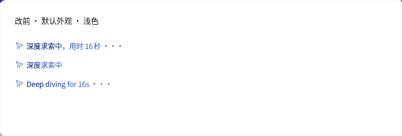
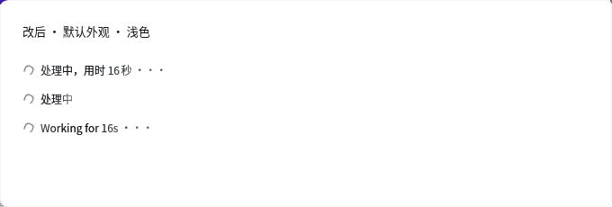
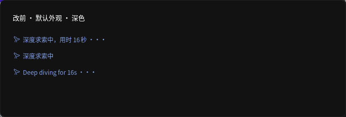
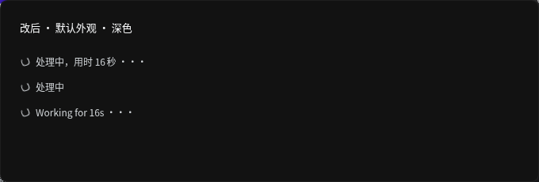
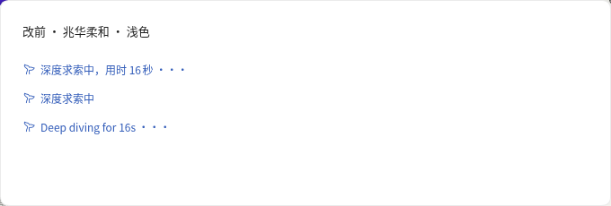
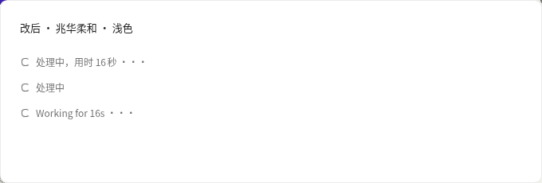
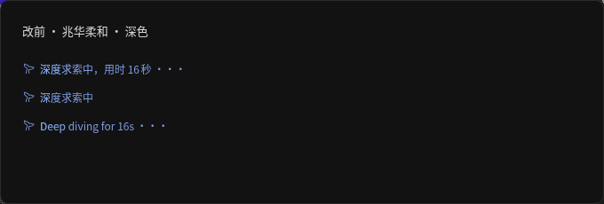
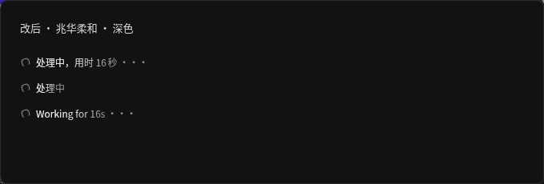

# 对话运行状态中性化

公司构建补丁 `crysound/scripts/patch-running-status.mjs` 只变换固定版本 `@deepseek-ai/dsh-client-ui-chat@0.2.2-rc.1` 的 `lib/client.js`，不修改上游源码。网页在镜像构建时执行；桌面在 `prepare-dsh.ts` 物化运行时后、生成完整性记录前执行，下个安装包生效。补丁核对版本和唯一命中位置，遇到上游变化停止构建；同版重复执行保持文件和权限不变，写入时断开硬链接，不修改 pnpm 存储。

八种语言沿用原字典键，使可见状态与无障碍播报同时中性化。中文为“处理中”“处理中，用时 {duration} ···”，英文为“Working”“Working for {duration} ···”；日语、西班牙语、法语、德语、俄语、葡萄牙语也改用“处理”语义。时间片段沿用原有本地化，因此中文截图显示“16秒”。公司层的发布组件测试承接原 running-status 测试的文案断言，上游源码及其测试保持原样。

图标改为使用 `currentColor` 的细线缺口圆环，1.6 秒匀速旋转；移除原鲸鱼组件和鲸鱼图片引用。减少动态效果或强制颜色模式下不旋转，隐藏占位时也停转。计时器、暂停恢复、隐藏占位和文字微光均沿用原组件。文字和图标使用 `--dsw-alias-label-secondary`，微光使用中性的 `--dsw-alias-label-primary`。

## 检查与复跑

无需安装依赖、构建或运行整套测试。先下载并解压公开发布包，原始包 SHA-256 为 `88456d772de0b4a028dca8c0b9e72013e3934455f210eb0929f7e7f09b8c2a8c`：

```sh
mkdir -p /tmp/running-status/ui-chat
curl -fsSL https://registry.npmjs.org/@deepseek-ai/dsh-client-ui-chat/-/dsh-client-ui-chat-0.2.2-rc.1.tgz -o /tmp/running-status/ui-chat.tgz
tar -xzf /tmp/running-status/ui-chat.tgz -C /tmp/running-status/ui-chat --strip-components=1
RUNNING_STATUS_PACKAGE=/tmp/running-status/ui-chat node --test crysound/scripts/tests/running-status.test.mjs
node --check crysound/scripts/patch-running-status.mjs
node --check crysound/scripts/tests/running-status.browser.mjs
```

四项测试覆盖八种语言的可见文字和播报、无起始时间、时间增加且播报不随秒数刷新、暂停恢复、起始时间在未来、隐藏占位和清理，另核对重复执行、上游变动拒绝、版本拒绝、失败前不写入、硬链接原件及文件权限。

浏览器复跑：用手册配置的持久浏览器入口 `newtab` 开自己的标签页，设置其编号与应用入口后执行；完成后 `closetab`。脚本只在该标签页拦截响应，在真实应用所用的 React、样式变量和 TextShimmer 上挂载发布包内的原 RunningStatus。改后响应先经过本 PR 同一补丁，再挂载同一组件；额外的导出和预览面板仅存在于验证页中。不给模型发消息，不改本人的外观偏好或服务端数据。

```sh
CDP_TAB=<自己的标签页编号> APP_ORIGIN=<应用入口> EVIDENCE_DIR=crysound/scripts/tests/evidence/running-status node crysound/scripts/tests/running-status.browser.mjs
```

`browser-report.json` 记录八组渲染的中英文文案、播报、实际计算颜色，以及减少动态效果、强制颜色、隐藏占位检查。改后四组的文字和图标计算颜色均等于同一元素下的次要文字色；微光也不再引用 DeepSeek 的蓝色变量。

| 外观 | 改前 | 改后 |
| --- | --- | --- |
| 默认浅色 |  |  |
| 默认深色 |  |  |
| 兆华柔和浅色 |  |  |
| 兆华柔和深色 |  |  |

这是发布组件在真实应用样式中的改前改后预览，未重建镜像、未验收新镜像上的真实对话运行生命周期、未构建或运行新桌面安装包。上线后伙伴助理先核对测试账号和本人，再按既有策略推广；真实运行中应显示中性状态行，停止后正常替换为操作行。

## 对话界面其他上游品牌痕迹

以下是源码核查，除本单的运行状态外均未扩大修改；不把源码存在等同于线上可见。

- `packages/client/ui-brand-official/src/client/Brand.tsx` 的 `OfficialBrandMark` / `OfficialBrandName` 仍调用 `FishLogo` / `BrandWordmark`。现有 `crysound/brand/brand.css` 已覆盖侧栏和新对话首页的品牌插槽；不能据此认定这些入口仍露出鲸鱼。
- `packages/client/ui-chat/src/client/locale.ts` 的 `message.failure.accountSignedOut` 与 `message.failure.accountSignInRequired` 在八种语言中仍提到 DeepSeek，`conversation-nodes/turn-error.ts` 也有对应英文错误文字。仅在有关账号失败路径出现，本单不改认证语义。
- `packages/client/ui-conversation/src/client/skeleton/InputBar.module.css` 的输入光标使用业务蓝色；`ContextMeter.module.css` 的消息分类使用 `--dsw-static-blue-450`。这些是可见蓝色候选，不足以单凭颜色认定为 DeepSeek 专属标志，由伙伴助理判断是否另立统一配色单。
