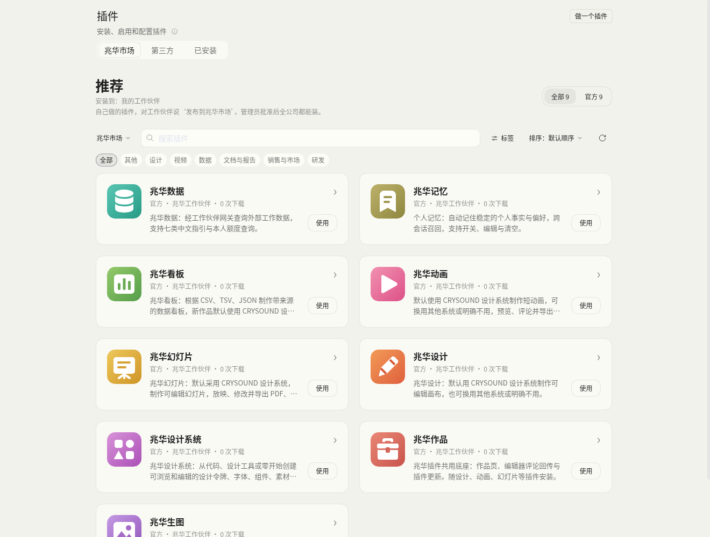
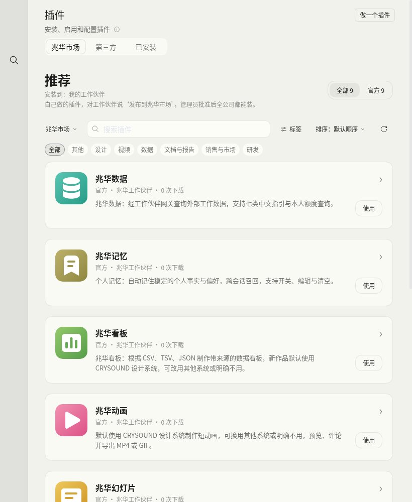
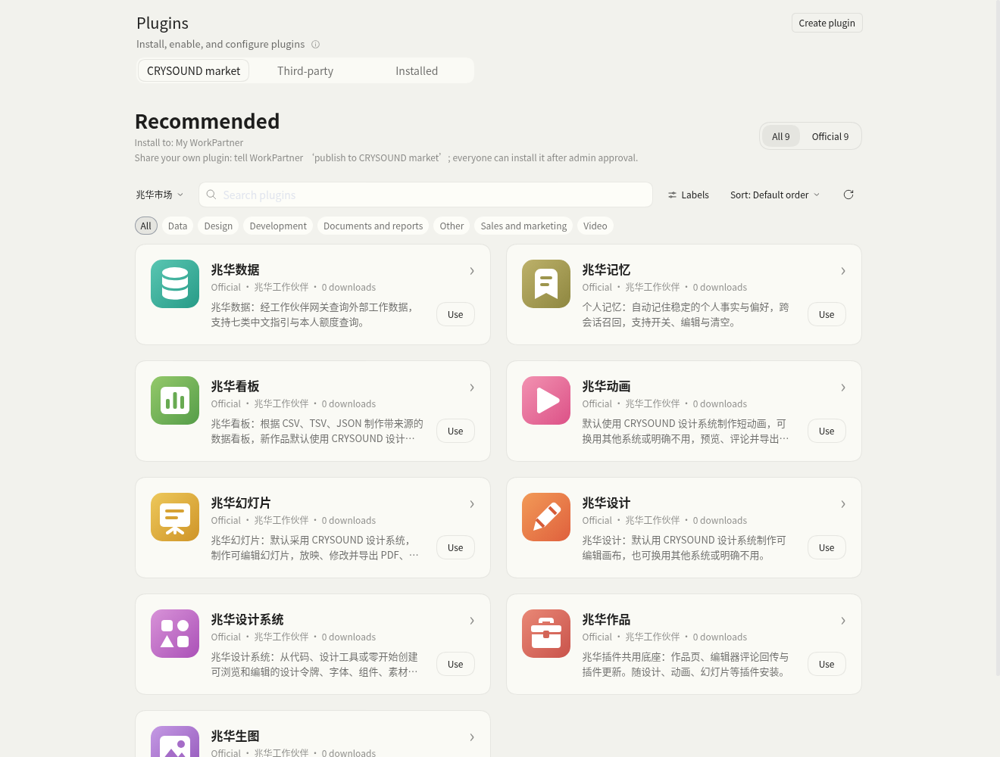
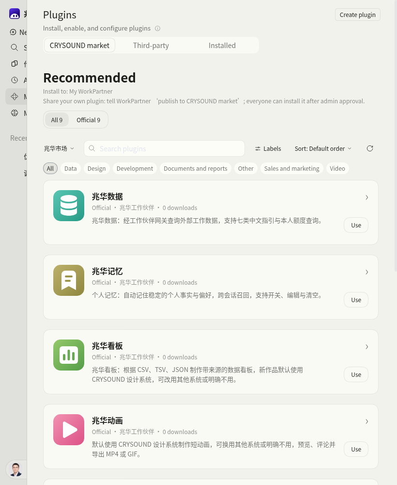

# Plugin publication guidance and review receipts

The implementation is based on main after PR #205 merged. Chinese and English browser checks use the persistent browser entry configured in the partner-issue skill, in a dedicated authenticated tab. Only that tab's released browser-module responses were replaced; the market listings, search and details came from the existing service. English used a tab-local locale bootstrap with preference persistence disabled. No model prompt, plugin upload, approval or real Feishu message was sent. The test tab was closed afterward.

[Checks](checks.json), [Chinese browser results](zh.json) and [English browser results](en.json) record the executed checks. The hint is 12px secondary gray text with transparent background and no accent border, only in the company market. The existing search, details, filters and other tabs passed. The initial clip-based screenshot method captured stale sidebar coordinates during responsive switching; the verifier now captures the whole viewport. Wide screenshots below are cropped offline to exclude the account sidebar; narrow screenshots retain the icon-only sidebar. No GIF is embedded: the market change adds static text, and real approval interactions require the separate test-account acceptance step.

Run the gateway checks with Node 24: `node --experimental-transform-types --test --test-isolation=none crysound/web/gateway/tests/market.test.mjs crysound/web/gateway/tests/notifications.test.mjs`. All 39 tests passed. They exercise actual publish/review HTTP handlers with a local registry fixture and injected message transport. New cases cover approved/rejected receipts, optional escaped rejection reasons, original-publisher routing, unavailable bots, transport failure, restarts, concurrent/duplicate reviews and state-save failures. The new cases reject the original main implementation. Test isolation was disabled because the locally available tsx loader otherwise causes the Node test-runner subprocess result decoder to fail after tests have run.

Run `node --test crysound/config/creator-publishing.test.mjs` with yaml resolved from the existing runtime via `DSH_CLI_ENTRY`; one test passed for new and existing temporary profiles, actual registration of the generated bilingual prompt and byte-identical repeat refresh. This checks instructions, not model compliance.

The existing `market-catalog.test.mjs` and `market-cards.test.mjs` passed all four cases against the pinned released modules supplied via `MARKET_RUNTIME_MODULES` and `THIRD_PARTY_CLIENT`. The generator's `--check`, 12 changed JavaScript syntax checks and `git diff --check` passed. No dependencies were installed, and no full suite, package build or image build was run.

Repeat browser evidence with `MARKET_RUNTIME_MODULES=<writable copy of the five original released browser modules> THIRD_PARTY_CLIENT=<published dshmarket client> CDP_TAB=<dedicated authenticated tab> node crysound/web/market/verify-cards.mjs <output>`, then repeat with `--english`. The script captures full viewport images; exclude the account sidebar before sharing screenshots.

Still required: real Creator mode completion and consent dialogue; test-account plugin submission, admin card, approved and rejected Feishu receipts (including a rejection reason); a publisher unable to receive bot messages; deployment and packaged desktop acceptance. Review-notification records are additive to market format 1; old records remain readable. A crashed or failed notification is not automatically retried, so the approval page reports unconfirmed delivery instead of repeating an approval.
