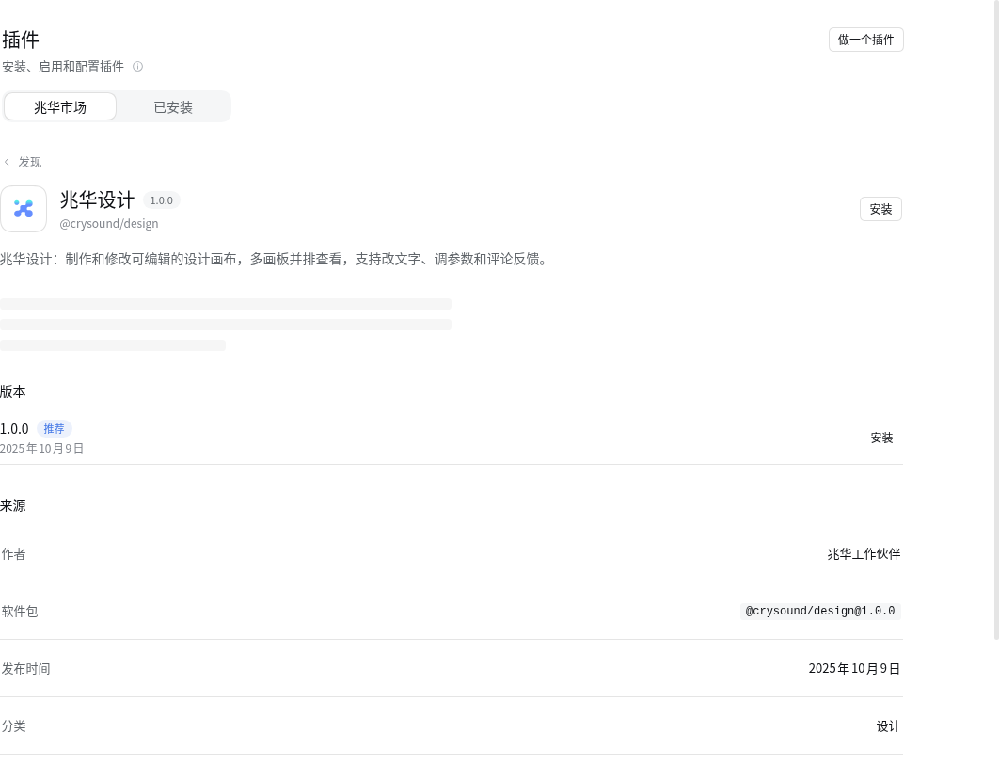
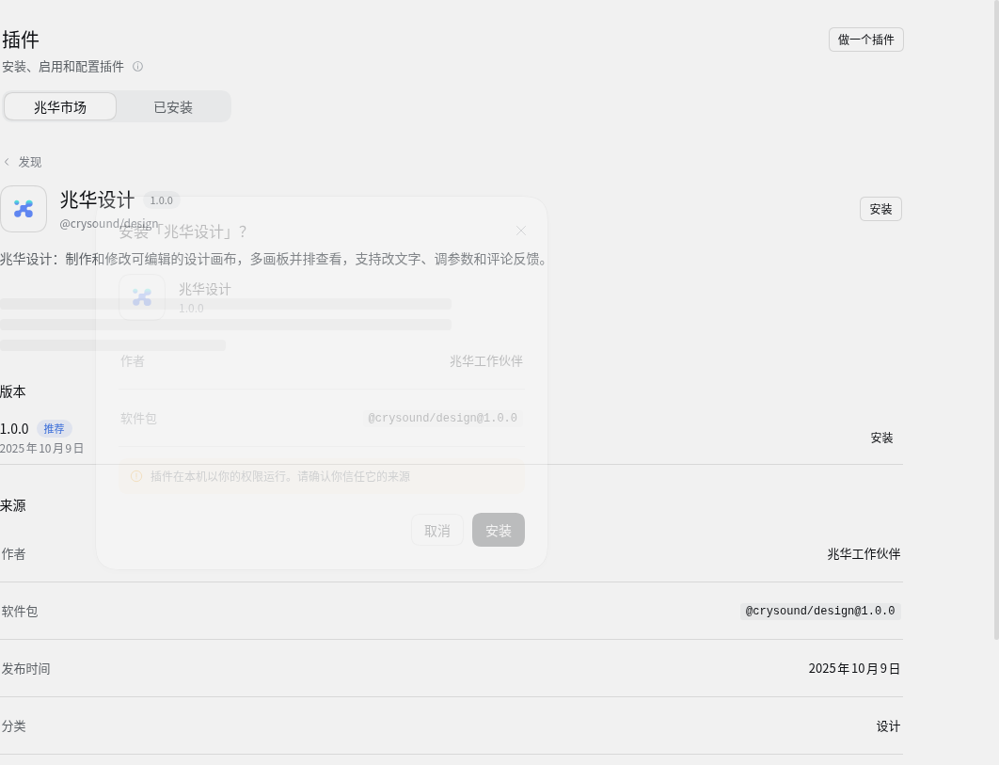
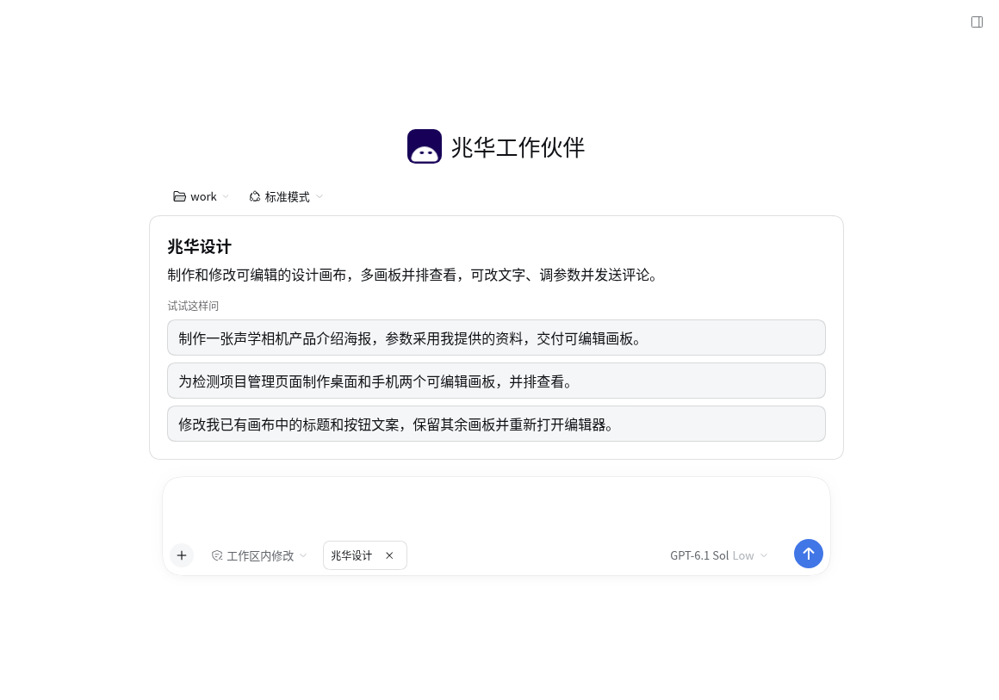

# 首页官方插件入口验收

本轮修复仅接续 #61 / #111 的导航问题。正式网页曾复现：首页点未安装的兆华设计后停在“已安装”列表。原生 `openBundle` 固定选择已安装标签，目标不存在时退回列表。

修复后的证据来自独立标签页中的原生 dsh 0.2.2-rc.1，实际运行分支修补后的发布模块与公司市场处理器。使用设计与作品底座 1.0.0 的真实包内容；市场审批、维护人和工作区状态是隔离合成数据，没有替换浏览器脚本响应、远端服务或会话。两种状态分别重启隔离网页并完整刷新。

- 未安装：从隔离 profile 的 bundles 与 dependencies 同时移除设计包引用，保留市场里的获批包。首页点击“兆华设计”直接选中“兆华市场”，打开 `@crysound/design@1.0.0` 的原生详情与安装按钮；点击安装可打开原生确认框，未确认安装。
- 已安装并启用：profile 引用设计与作品底座真实本地包。首页点击后出现包内说明、逐字匹配的三个示例及能力标签；市场“使用”仍进入同一说明卡。
- 先在市场搜索无结果，再回首页点设计，仍打开设计详情；“去市场看看”清除定位并打开公司市场列表。
- 两种状态完整启动均无插件加载失败，当前页控制台均无错误。完整断言和 profile 状态摘要见 [acceptance.json](acceptance.json)。

本轮只验证导航，不重复提交模型请求、不修改正式账号插件或作品。详情中的介绍文档继续走原生读取，私有包说明文档的公共读取限制仍适用。部署后两种点击状态及三个示例的线上技能调用由伙伴助理验收，Electron 成品沿用下次正常桌面构建时验收的约定。

## 多来源顺序回归

评审指出：旧工作区可能把别的索引放在公司索引之前。定位改为查找公司索引的固定路径，不再取第一个来源；原生冷启动完成最初来源选择后再定位公司来源，避免异步加载覆盖选择。已有 v2 导航补丁可原地升级为 v3。

新增用例在修复前失败，修复后 12 项轻量回归全部通过。真实原生网页把空的其他索引放第一、公司索引放第二，完整刷新后首页点击仍进入公司设计详情与安装确认；旧搜索、去市场看看均通过。来源菜单也实际显示其他来源在第一、兆华市场在第二；手动切到其他来源，再从首页点击设计，最终详情的插件索引仍是兆华市场。断言与状态见 [source-order.json](source-order.json)。

原有已启用说明卡证据继续有效；本次未改能力激活、引导或模型提交路径。原 PR 在本次修复期间已合入，来源顺序修复单独交付，部署后验收仍待伙伴助理完成。
