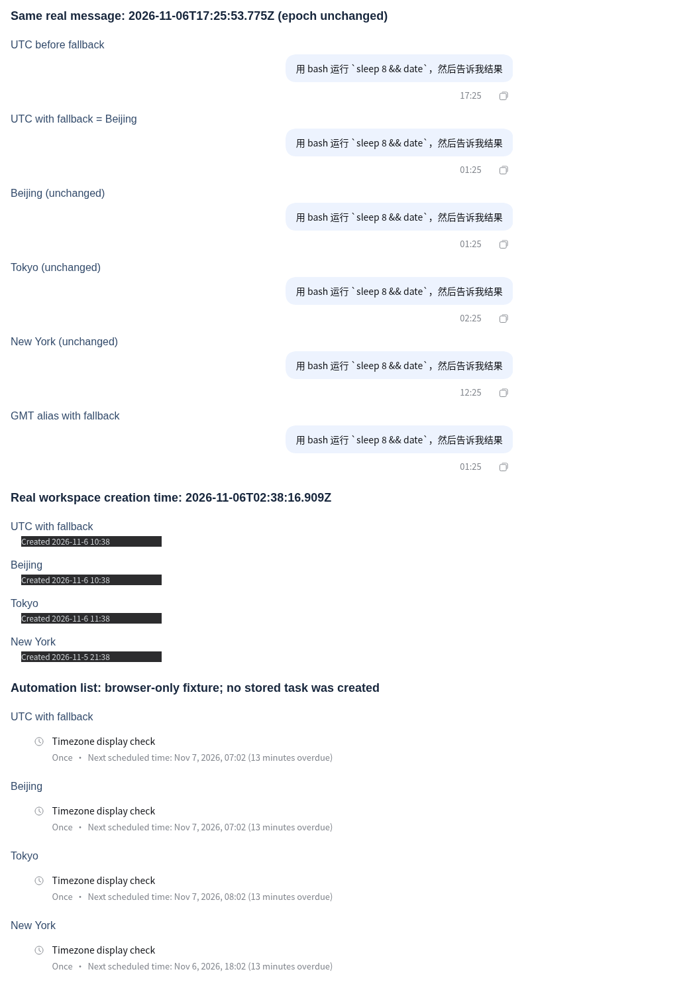

# UTC 浏览器的北京时间兜底

2026-11-07 在已登录的正式网页专用标签页中，用浏览器协议切换时区，并在文档创建时注入本分支的 `crysound/brand/timezone.js`，早于前端执行。测试结束后移除注入、清除时区覆盖；本轮没有部署。图片为真实组件截图的裁剪拼图，标题用于说明测试场景，截图中的时间文字未改动。

同一条真实消息的原始时间戳始终为 `1793985953775`，修复前 UTC 显示 `17:25`，启用兜底后显示 `01:25`，与北京一致。东京仍为 `02:25`，纽约仍为 `12:25`。另外三条消息同样通过；GMT 别名也走兜底。

工作区创建时间来自真实数据，四时区核对实际悬浮卡片。测试浏览器声明不支持鼠标悬停，因此用笔指针事件打开现有卡片；未改组件或数据。会话列表的相对时长沿用原有时间戳计算。

自动化列表使用仅在本标签页拦截目录读取时返回的测试数据：目标时间为 `2026-11-06T23:02:00.000Z`，规则显式指定 UTC。UTC 兜底与北京显示 `11月7日 07:02`，东京为 `08:02`，纽约为前一天 `18:02`。打开手动创建表单后，默认日期、下一小时的时间和系统时区也逐一核对，未保存或执行任务。`evidence.json` 保留核对值，省略账号、目录和其他对话内容。

本地可复跑 `node crysound/scripts/check-timezone.mjs`：以北京原生结果作参照，比对 UTC/GMT 兜底的日期格式化、本地取值、跨日设值、午夜、默认任务时间，并核对显式时区、UTC 方法、时间戳、序列化、重复加载、非法日期和其他时区保持原行为。还在临时目录执行了 Dockerfile 实际品牌复制和 HTML 注入片段，确认脚本内容与版本号正确、网页和桌面的入口均为先于模块执行的同步脚本。

以下验收留给交付：重建镜像并更新空闲用户容器后的正式页面、实际平板上的飞书内置浏览器、桌面安装包。原生日期构造和字符串解析规则不变；本地字段兜底按现代北京时间 UTC+08:00，不模拟历史夏令时。回退时撤下网页与桌面的脚本入口并按原发布方式更新。
